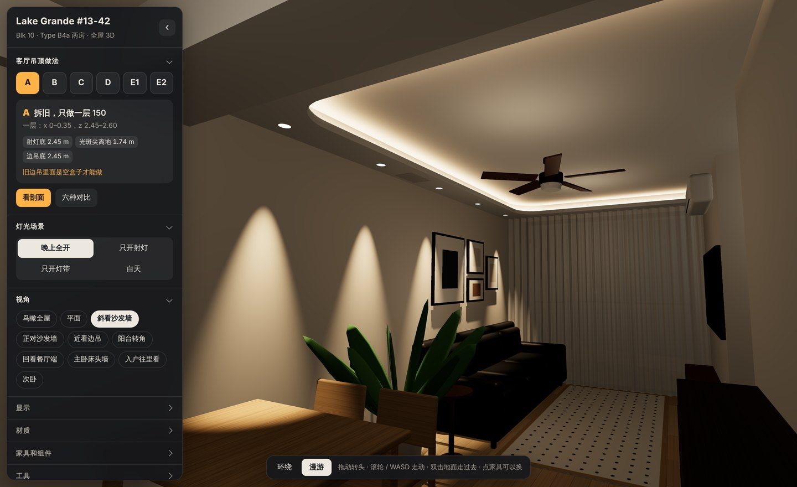

# Lake Grande #13-42 全屋 3D

Blk 10 · Type B4a 两房的可交互 3D 模型。尺寸按《全屋 3D 建模说明》（2026-11-25），重点是客厅沙发墙和主卧的吊顶与灯光。

在线地址：<https://dcyber-lab.github.io/home3D/>



## 能做什么

- **六种客厅吊顶做法**（A / B / C / D / E1 / E2）一键切换，同一个场景里曝光一致，可以直接对比。
- **四个灯光场景**：晚上全开、只开射灯、只开灯带、白天。
- **十个固定视角**：鸟瞰、平面，加上说明文档里的斜看、正对沙发墙、近看边吊、阳台转角、回看餐厅端、主卧床头墙等。
- **家具和组件可以换**：点场景里的家具，改款式、面料、尺寸、位置、朝向；选中后按住可以拖动；可以添加、复制、删除。
- **每个做法可以移除客厅射灯**：做法卡片里有「客厅射灯」开关，关掉就是这个做法不装射灯（灯具、光斑、尺寸标注、施工图里的射灯一起去掉，检修口保留）。六个做法各记各的，按钮右上角有标记；主卧射灯不受影响。
- **客厅射灯的数量和光束角可调**：做法卡片里「数量」1–8 个，沿沙发墙等分重排（两端各留半个间距，5 个就是文档的 0.45 起、每 0.90）；「光束角」15° / 24° / 36° / 60°。光斑尖高度、尺寸标注、检修口位置、施工图都跟着变。六个做法共用这一组设置，主卧射灯不受影响。
- **显示开关**：家具、画框、窗帘可以单独隐藏。
- **给施工队看的东西**：尺寸标注、新旧分色、量距离、剖切高度，以及五张施工图（当前做法剖面、六种剖面对比、客厅天花布置、主卧天花布置、全屋平面），可以打印或存 PDF / SVG。
- **给工人的只读链接**：「工具」→「只读链接（给工人）」，把现在定下来的方案生成一个只能看、不能改的链接，见下面一节。
- **分享链接（给自己）**：地址栏会记住做法、场景、视角、哪些做法移除了射灯、射灯的数量和光束角，「复制链接」发给别人，打开就是同一个画面。

## 操作

| | 电脑 | 手机 |
| --- | --- | --- |
| 环绕（从外面看） | 拖动旋转，滚轮缩放，右键平移 | 单指旋转，双指缩放平移 |
| 漫游（站在屋里） | 拖动转头，滚轮或 WASD 走动，Q / E 升降 | 单指转头，双指捏合前进后退 |
| 走到某个位置 | 双击地面 | 双击地面 |
| 选中家具 | 单击 | 轻点 |

相机在屋外时，挡视线的楼板和近侧外墙会自动隐藏。

## 给工人的只读链接

方案定好之后，在面板「工具」里点「只读链接（给工人）」，会生成一个 `view.html#…` 开头的链接并复制好，直接发给工人。

链接里固定的是生成那一刻的整套方案：选的做法、客厅射灯（数量、光束角，或者不装）、主卧射灯光束角、地板和墙面、家具布置（包括你在自己浏览器里改过、还没更新到仓库的那些），以及打开时的灯光场景和视角。

工人打开后：

- **能做的**：转视角、换灯光场景、开关尺寸标注、量距离、点家具看尺寸、看和打印施工图。
- **不能做的**：换做法、改射灯、改材质、动家具。页面上没有这些入口，也不会往工人的手机里存任何东西。
- **链接改不了**：内容和校验码一起编在链接里，少一段或者改一个字符，页面只会提示「链接打不开」，不会显示成别的方案，也不会变成可编辑的页面。

需要知道的三点：

- 你之后再改方案，已经发出去的链接内容不变。要给工人新方案，重新生成一个发过去，并告诉他们旧的作废。
- 墙体、吊顶这些尺寸不在链接里，只读页面读的是仓库里的 `data/home.json`。所以现场量完更新了尺寸，旧链接打开也会是新尺寸；更新时把 `meta.version` 改成新日期，只读页面的页脚会注明尺寸数据在链接生成之后更新过。
- 这是「看得到、改不了」，不是保密：仓库和页面都是公开的，知道网址的人可以打开可编辑的页面自己试，但他们试的结果只在他们自己的浏览器里，改不了你发出去的链接，也改不了仓库。

## 怎么改

所有尺寸都在 **`data/home.json`** 一个文件里，改完保存、刷新页面就生效。坐标是说明文档的坐标：原点在客厅沙发墙内表面 × 阳台推拉门线，x 向右，y 向入户门，z 向上，单位米，量的都是内表面。

| 想改什么 | 改哪里 |
| --- | --- |
| 房间、墙、门窗洞 | `walls`（每面墙一个矩形，`openings` 是门窗洞）、`floors`、`rooms` |
| 天花高度、旧边吊 | `heights`、`ceiling.oldBox`、`ceiling.diningTransverse` |
| 客厅吊顶的六种做法 | `ceiling.living.options`；公共参数（灯槽宽、挡边、射灯位置、转角半径）在 `ceiling.living.common`。某个做法里写 `"noSpots": true`，它默认就不装客厅射灯 |
| 主卧吊顶和射灯 | `ceiling.master` |
| 家具 | `furniture`，每件一行：`type` 款式、`x` `y` 占地范围、`h` 高、`face` 朝向、`finish` 面料 |
| 灯的亮度和颜色 | `lights` |
| 固定视角 | `cameras` |
| 待现场确认的清单 | `toConfirm` |

现场量完之后，最常改的是这两个数：`ceiling.living.y`（客厅段长度，现在 4.50）和 `heights.ceiling`（原天花高度，现在 2.60）。射灯位置在 `ceiling.living.common.spots.y`（一个射灯一个数，离阳台门线的距离），光束角是同一处的 `beam`；页面上能选的光束角在 `beamChoices`。

### 在页面上改家具

在页面上拖、换、加的改动只存在你自己的浏览器里。要让别人也看到：

1. 面板「家具和组件」→「导出 JSON」，得到一份完整的 `home.json`。
2. 用它替换仓库里的 `data/home.json`，提交。
3. GitHub Actions 会自动重新发布，一两分钟后线上就是新的。

如果改了仓库里的 `home.json` 但自己浏览器里还是旧的，是因为本机存着以前的改动：点「恢复默认」，或者把 `meta.version` 改成新的日期。

### 加一种新组件

组件库在 `src/furniture.js`。在 `COMPONENTS` 里加一项，写一个 `build` 函数（给宽、深、高和面料，返回一组网格），`home.json` 里的 `type` 写它的名字就能用，页面上的款式下拉里也会出现。面料和木色在 `src/materials.js` 的 `FINISHES`。

## 本地预览

页面要通过 HTTP 打开（直接双击 `index.html` 读不到数据文件）：

```bash
python3 -m http.server 8000
```

然后打开 <http://localhost:8000>。没有构建步骤，three.js 已经放在 `vendor/` 里。

## 目录

```
index.html            页面（可编辑）
view.html             给工人的只读页面，内容由链接里的令牌决定
css/style.css         界面样式
data/home.json        全屋数据（唯一数据来源）
src/main.js           入口
src/app.js            场景、状态、按需渲染、自动剖切
src/shell.js          结构板、地面、墙、门窗、阳台、窗帘、楼板
src/ceiling.js        客厅六种吊顶、主卧 L 形边吊、射灯和灯带
src/lighting.js       四个灯光场景
src/furniture.js      家具 / 设备组件库
src/materials.js      材质和面料
src/controls.js       环绕 / 漫游相机
src/editor.js         点选、拖动、测量、导入导出
src/share.js          只读链接：打包、校验、还原
src/annotations.js    房间名、尺寸线、门的开启弧线
src/drawings.js       SVG 施工图
src/ui.js             面板
vendor/three/         three.js r170（MIT）
```

## 模型里的取值

**按说明文档**：客厅宽 2.755、电视墙段 1.71、主卧 2.67 × 3.80、次卧深 3.12 用实测值；房间之间的相对位置按酷家乐；六种吊顶的剖面、灯槽、挡边、射灯、检修口、主卧 L 形边吊都按文档的数字。

**文档没给、我按酷家乐平面估的**（页面里「待现场确认」也列了）：

- 门窗洞口的位置和大小、墙厚、阳台外沿的折线。
- 为了让实测值和酷家乐的相对位置同时成立：次卧窗墙和主卧窗墙对齐在 y = −1.54，次卧往里 3.12 到 y = 1.58；主卧床头墙在 x = 8.79，往左 2.67 到 x = 6.12，所以次卧和主卧之间的墙画得比实际厚。
- 主卧门在走廊尽头（x ≈ 5.15），主卧衣柜贴着主卫墙、正面在 v = 3.80。
- 入户柜的位置和尺寸、入户走廊低吊顶（按手写的 2393 高）、厨房和卫生间的布置。
- 主卧书桌比文档表格短一点（y −1.32 到 −0.32），因为床按文档的 1.8 宽、中心 v = 2.20 建模后会跟原来的书桌位置重叠。

## 渲染说明

这是浏览器里的实时渲染，不是光线追踪：

- 射灯是开阴影的聚光灯，光束角 24° 对应 `angle 17°、penumbra 1`，光斑尖的位置是准的。
- 灯带是朝上的面光源，面光源不投阴影，所以灯带都放在挡边里面；转角分成几段短光源。
- 没有全局光照，天花和墙面的反射用几盏不投影的补光近似，所以整体明暗只能看趋势，不能当照度计算。
- 「其他房间照明」是为了看清户型加的，文档里没有这些灯，可以在「显示」里关掉。
